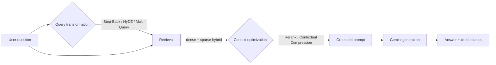

# Advanced RAG — Product Research Assistant

A hands-on Retrieval-Augmented Generation system that answers technical questions
about laptop documentation, built to demonstrate the end-to-end RAG lifecycle:
ingestion, dense + sparse retrieval, query transformation, context optimization,
grounded generation, and quantitative evaluation with Ragas.

The knowledge base contains two real product lines — the **Lenovo ThinkPad T14
Gen 5 (Intel)** and the **Dell XPS 13 9340** — as spec sheets and owner manuals.

## Why this project

It is not a single "chat with docs" demo. It implements a **baseline RAG pipeline**
and then adds **six interchangeable optimization techniques**, each evaluated with
the same labelled question set so their impact can be compared directly. Every
technique lives behind the same `answer_*(question) -> Answer` interface and is
selectable from the evaluation CLI, which makes the design modular and
experiment-driven.

## RAG Pipeline



1. **Ingestion** — PDFs are loaded, split into overlapping chunks, embedded, and
   stored in a single Pinecone index.
2. **Retrieval** — dense semantic search, optionally combined with a learned sparse
   signal (hybrid).
3. **Optimization** — retrieved context is refined by query transformation and/or
   context optimization.
4. **Generation** — Google Gemini produces grounded answers with page-level source
   attribution and prompt-injection-aware handling of retrieved content.
5. **Evaluation** — Ragas scores every technique against the same questions.

## Optimization Techniques

| # | Technique | Category | Model / Method |
|---|---|---|---|
| 1 | Step-Back Prompting | Query transformation | Gemini rewrites the question to a broader "step-back" question, retrieval is merged |
| 2 | HyDE | Query transformation | Groq drafts a hypothetical answer, which is embedded for retrieval |
| 3 | Multi-Query + RRF | Query transformation | Groq generates paraphrases; ranked lists are fused with Reciprocal Rank Fusion |
| 4 | Hybrid Search | Retrieval | Dense (Ollama) + sparse (`pinecone-sparse-english-v0`) blended by an alpha weight |
| 5 | Reranking | Context optimization | Cross-encoder rerank via OpenRouter (`nvidia/nemotron-3.5-rerank-8b:free`) re-scores a wide candidate set |
| 6 | Contextual Compression | Context optimization | Gemini extracts only the question-relevant, verbatim passages from each chunk |

Implementation notes:

- **Hybrid Search** — applies convex scaling to dense and sparse query vectors:
  `alpha * dense` and `(1 - alpha) * sparse`. The alpha value is configurable via
  `HYBRID_ALPHA`.
- **Reranking** — achieved the strongest overall balance
  between Context Precision and Context Recall.
- **Contextual Compression** — an extractive LLM step that copies relevant text
  verbatim (no paraphrasing), drops irrelevant chunks, and preserves
  document/page metadata so citations stay accurate.

## Tech Stack

| Category | Technology |
|---|---|
| Language | Python 3.13 |
| LLM orchestration | LangChain / LCEL |
| Generation | Google Gemini |
| Query transformation | Gemini, Groq |
| Dense embeddings | Ollama — `all-minilm` |
| Sparse embeddings | Pinecone Inference |
| Vector database | Pinecone |
| Reranking | NVIDIA Nemotron via OpenRouter |
| Evaluation | Ragas |
| Observability | Langfuse |
| Packaging | uv |

## Repository Structure

```text
advanced-rag/
├── src/
│   ├── ingestion.py                 # load → chunk → embed (dense + sparse) → upsert
│   ├── retrieval.py                 # dense + hybrid retrieval
│   ├── generation.py                # grounded Gemini generation + streaming
│   ├── llm.py                       # shared Groq LLM builder
│   ├── evaluation.py                # Ragas evaluation harness + technique CLI
│   ├── dataset_utils.py             # base questions + per-technique artifacts
│   ├── build_datasets.py            # generate HyDE / Multi-Query artifacts
│   ├── tracing.py                   # optional Langfuse instrumentation
│   ├── main.py                      # interactive streaming CLI
│   └── techniques/
│       ├── query_transformation/    # step_back.py, hyde.py, multi_query.py
│       ├── retrieval/               # hybrid.py, rerank.py
│       └── context_optimization/    # compression.py
├── data/
│   ├── documents/                   # Lenovo + Dell PDFs
│   └── evaluation/questions.json    # 8 labelled questions + references
├── experiments/
│   ├── datasets/                    # generated technique artifacts
│   └── results/                     # Ragas results per experiment
├── .env.example
├── pyproject.toml
└── README.md
```

## Getting Started

### Prerequisites

- Python 3.13+
- [uv](https://docs.astral.sh/uv/)
- [Ollama](https://ollama.com/) with the embedding model
- Pinecone account
- Google AI (Gemini) API key
- Groq API key (query transformation + default judge)
- OpenRouter API key (reranking + optional judge)

### Installation

```bash
git clone https://github.com/YOUR_USERNAME/advanced-rag.git
cd advanced-rag
uv sync
ollama pull all-minilm
```

### Configuration

Copy `.env.example` to `.env` and fill in the keys and model names:

```bash
PINECONE_API_KEY=...        GOOGLE_API_KEY=...        GROQ_API_KEY=...
OPENROUTER_API_KEY=...      GOOGLE_MODEL=...          GROQ_MODEL=...
OLLAMA_EMBEDDING_MODEL=...  PINECONE_INDEX_NAME=...   HYBRID_ALPHA=0.9
OPENROUTER_RERANK_MODEL=nvidia/nemotron-3.5-rerank-8b:free
JUDGE_PROVIDER=openrouter   # judge provider (defaults to groq if unset)
# Optional tracing
LANGFUSE_PUBLIC_KEY=...     LANGFUSE_SECRET_KEY=...   LANGFUSE_BASE_URL=...
```

### Ingest the documents

```bash
uv run python src/ingestion.py --reset   # (re)ingest the configured sources
uv run python src/ingestion.py --wipe    # clear the index first (destructive)
```

### Run interactively

```bash
uv run python src/main.py
```

## Evaluation

The system is evaluated with **Ragas** over **8 fixed questions** (with reference
answers) using four metrics:

- **Faithfulness** — are claims supported by the retrieved context?
- **Answer Relevancy** — does the answer address the question?
- **Context Precision** — is retrieved context relevant/well-ranked?
- **Context Recall** — does retrieved context cover the reference answer?

The judge is Groq by default, or OpenRouter when `JUDGE_PROVIDER=openrouter`.
Answer-relevancy scoring uses the same Ollama embeddings.

Generate the technique-specific artifacts, then evaluate any technique:

```bash
uv run python src/build_datasets.py          # HyDE + Multi-Query artifacts
uv run python src/evaluation.py --technique hybrid
uv run python src/evaluation.py --technique compression
```

Available techniques:
`standard` (baseline), `step_back`, `hyde`, `multi_query`, `hybrid`, `rerank`,
`compression`. Results are written to `experiments/results/<technique>/results.json`.

### Results

Measured on the same 8-question set (higher is better; best per column in **bold**):

| Technique | Faithfulness | Answer Relevancy | Context Precision | Context Recall |
|---|---|---|---|---|
| baseline | 0.667 | **0.947** | 0.872 | 0.812 |
| step_back | 0.641 | 0.947 | 0.820 | 0.812 |
| hyde | **0.852** | 0.944 | 0.865 | 0.875 |
| multi_query | 0.725 | 0.932 | 0.845 | **1.000** |
| hybrid | 0.819 | 0.944 | 0.740 | 0.750 |
| rerank | 0.743 | 0.944 | **0.937** | 0.938 |
| compression | 0.305 | 0.704 | 0.750 | 0.562 |

Takeaways:

- **Reranking** gives the best context precision/recall balance.
- **HyDE** gives the biggest faithfulness gain over baseline.
- **Multi-Query** maximizes context recall, at some precision cost.
- **Contextual compression** underperformed on this set as implemented (aggressive
  extraction can prune context the judge expects) — a clear example of using the
  evaluation harness to catch a technique that needs tuning rather than assuming it
  helps.

**Evaluation limitations:** Results are based on a fixed set of 8 questions and
should be treated as experimental observations, not statistically significant
benchmark results. LLM-as-a-judge scores may vary depending on the evaluator model
and provider.

## Observability

Set the `LANGFUSE_*` variables to trace every request. The pipeline emits a
`rag-answer` trace containing a nested `retrieve-context` (retriever) step and the
Gemini generation, tagged by technique. Tracing is a no-op when the keys are absent.

## Key Engineering Decisions

- **Single Pinecone index for dense and sparse representations** — both vector
  types coexist per chunk, so switching between dense-only and hybrid retrieval
  needs no re-indexing.
- **Consistent interface across retrieval techniques** — every technique returns an
  `Answer` with the exact retrieved sources, so evaluation and the CLI work
  uniformly across all of them.
- **Separation of generation, retrieval, and evaluation** — each layer lives in its
  own module (`generation.py`, `retrieval.py`, `evaluation.py`), coupled only by the
  shared `Answer` contract.
- **Precomputed query transformations reused to avoid unnecessary LLM calls** — HyDE
  and Multi-Query outputs are generated once into `experiments/datasets/` and
  reloaded during evaluation, and shared clients/models are `@lru_cache`d.
- **Reproducible evaluation dataset** — a fixed 8-question set with reference
  answers (`data/evaluation/questions.json`), with per-technique artifacts and
  results versioned under `experiments/`.
- **Grounded, cited, injection-aware generation** — the system prompt restricts the
  model to retrieved context, requires page-level citations, and treats retrieved
  content as untrusted data.
